# The Original Deal: Visual Shot Map

| | |
|---|---|
| **Voiceover** | 46.6 s: a hunter-gatherer, freedom and responsibility (full transcript at the end) |
| **Cut length** | 47.6 s (the voiceover plus a 1 s end hold) |
| **Format** | 9:16 vertical, 1080×1920, 24 fps, sized for Shorts like `hardware-ladder-ep3-rebuild` |
| **Generator** | Google Gemini Omni Flash ("Omni") |
| **Clip plan** | 16 shots: 12 × 4 s and 4 × 6 s, so 72 s of generation for 47.6 s on screen. No 8 s clips. |
| **Prompts** | [`prompts.md`](prompts.md) has one copy-paste prompt per shot, numbered the same way |

**The story in one breath.** A modern hand finds an ancient handprint in a cave. We drop back in time to the man who made it. We see his deal: total freedom, total accountability. We watch the deal run as a loop until the day it kills him. Then dawn comes, and a person from today stands in the same spot.

---

## 1. Emotional arc

| Act | On screen | Voiceover beat | Emotion target | Light and color | Rhythm |
|---|---|---|---|---|---|
| **I · Hook** | 0.00–3.30 | "let's go back thousands of years" | curiosity → wonder | cold LED → amber firelight | 1 shot, slow push-in |
| **II · The World** | 3.30–15.35 | hunt, eat, rest … faded into oblivion | immersion → exposure → urgency → loss | dawn gold → bleached sun → drained grey | **fast**: 5 shots in 12 s, one of them a 3-cut montage |
| **III · Freedom** | 15.35–22.80 | a kind of freedom … infinite autonomy | release → awe | the warmest gold in the film | **slow**: 2 long shots, the camera opens up |
| **IV · The Catch** | 22.80–29.30 | but with a catch … you are accountable | weight → confrontation | blue night against a small fire, split light on the face | slow push-ins, one look into the lens |
| **V · The System** | 29.30–41.10 | think of it as a system … someone else's meal | curiosity → momentum → shock | ochre and charcoal by torchlight → black | rhythmic, speeding up, then a **dead stop** |
| **VI · Resolution** | 41.10–47.60 | the most natural thing humans have ever done | resolve → recognition | pink-gold dawn | 2 shots, a match cut, a hold |

## 2. Timeline

```mermaid
gantt
    title The Original Deal · 16 shots · 47.6 s (bar = time on screen)
    dateFormat x
    axisFormat %S s
    todayMarker off
    section I · Hook
    S01 The Reach          :s01, 0, 3300
    section II · The World
    S02 Imagine            :s02, 3300, 6150
    S03 Hunt Eat Rest      :s03, 6150, 7350
    S04 No Safety Net      :s04, 7350, 10900
    S05 Tried Harder       :s05, 10900, 13300
    S06 Oblivion           :s06, 13300, 15350
    section III · Freedom
    S07 Awakening          :active, s07, 15350, 20600
    S08 Infinite Autonomy  :active, s08, 20600, 22800
    section IV · The Catch
    S09 Empty Hand         :s09, 22800, 26000
    S10 The Deal           :s10, 26000, 29300
    section V · The System
    S11 The Wall           :s11, 29300, 31700
    S12 Trigger            :s12, 31700, 33850
    S13 Act Effort Need    :s13, 33850, 37250
    S14 Someone Else's Meal :crit, s14, 37250, 41100
    section VI · Resolution
    S15 Dawn               :active, s15, 41100, 43720
    S16 Match Cut          :active, s16, 43720, 47600
```



Emotional intensity by shot, as the arc above should feel:

```
shot       S01 S02 S03 S04 S05 S06 S07 S08 S09 S10 S11 S12 S13 S14 S15 S16
intensity   ▂   ▃   ▄   ▄   ▆   ▂   ▅   █   ▃   ▆   ▃   ▄   ▆   █   ▄   ▆
                            urgency    awe      you             shock  that's us
```

Highs and lows alternate on purpose. Every peak is followed by a drop (S05→S06, S08→S09, S14→silence), so each peak stands out by contrast.

## 3. Shot list at a glance

Times are positions on the voiceover. Each cut sits 0–6 frames ahead of the first word of the next idea; the cut points were measured from the waveform.

| # | On screen | Gen | Voiceover | Picture | Palette |
|---|---|---|---|---|---|
| **S01** | 0.00–3.30 (3.30 s) | 4 s | "To find an answer, let's go back thousands of years." | A modern hand reaches for an ancient ochre hand stencil; the flashlight turns into firelight | 🟦→🟧 |
| **S02** | 3.30–6.15 (2.85 s) | 4 s | "Imagine a hunter-gatherer. His job is survival." | The hunter rises out of golden grass; push-in to his eyes | 🟨🟧 |
| **S03** | 6.15–7.35 (1.20 s) | 4 s | "Hunt, eat, rest," | Three smash cuts: spear thrust, then tearing meat at the fire, then sleeping under the stars | 🟨🟧🟦 |
| **S04** | 7.35–10.90 (3.55 s) | 4 s | "no government, no safety net, no salary." | A tiny figure crosses a fallen log over a sheer gorge | ⬜🟩 |
| **S05** | 10.90–13.30 (2.40 s) | 4 s | "If you couldn't find food today, you tried harder" | Handheld sprint through the grass after unseen prey | 🟨⬜ |
| **S06** | 13.30–15.35 (2.05 s) | 4 s | "or you faded into oblivion." | He walks into fog and vanishes; the frame stays empty | ⬜🟦 |
| **S07** | 15.35–20.60 (5.25 s) | 6 s | "And he had a kind of freedom. Nobody told him when to wake up or where to go." | Sunrise on his sleeping face; he wakes as the camera pulls back to the endless valley | 🟧🟨 |
| **S08** | 20.60–22.80 (2.20 s) | 4 s | "Infinite autonomy." | Top-down rise: he stands at the hub of trails running in every direction | 🟨🟧 |
| **S09** | 22.80–26.00 (3.20 s) | 4 s | "But with a catch, responsibility, nobody was going to feed him." | Night; he sits alone at a small fire; his empty palm closes into a fist | 🟦🟧 |
| **S10** | 26.00–29.30 (3.30 s) | 6 s | "That's the original deal. You can be free, but you are accountable." | He blows ochre over his hand (the S01 stencil), then looks into the lens | 🟧🟦 |
| **S11** | 29.30–31.70 (2.40 s) | 4 s | "Think of it as a system." | Torchlight reveals a circle of cave paintings, with his stencil at the center | 🟫🟥 |
| **S12** | 31.70–33.85 (2.15 s) | 4 s | "A situation triggers the need to survive." | The painted herd gallops; the painted hunter stands | 🟫🟥 |
| **S13** | 33.85–37.25 (3.40 s) | 4 s | "You act, you put in effort, you meet the need." | The painted hunter throws, chases, then eats by the painted fire | 🟫🟥 |
| **S14** | 37.25–41.10 (3.85 s) | 6 s | "Rinse and repeat until one day you become someone else's meal." | The loop speeds up, a painted lion swallows him, the torch dies, black | 🟫→⬛ |
| **S15** | 41.10–43.72 (2.62 s) | 4 s | "So living with freedom and responsibility together" | Dawn; the hunter on the ledge, silhouetted, begins a step | 🟪🟧 |
| **S16** | 43.72–47.60 (3.88 s) | 6 s | "is actually the most natural thing humans have ever done." | Match cut: the modern hiker finishes the same step; a town wakes in the valley | 🟪🟧 |

---

## 4. Shot cards

### S01 · The Reach (Hook)
- **On screen:** 0.00–3.30 · **Generate:** 4 s · **Use:** clip 0.0–3.3 s
- **Voiceover:** "To find an answer, let's go back thousands of years."
- **Picture:** Extreme close-up in a dark rock shelter. A phone flashlight finds a red-ochre stencil of a left hand. A modern left hand with a smartwatch reaches up from the bottom of the frame to match it. On "go back thousands of years" the white light flickers into firelight and the pigment looks freshly wet. The fingertips hover and never touch.
- **Camera:** 50 mm macro, slow push-in, shallow focus.
- **Light/color:** cold blue-white LED → warm amber fire.
- **Emotion:** curiosity → wonder.
- **Why it works:** Frame one already shows a mystery, with no preamble. That is the strongest hook pattern for Shorts. The light change *is* the time travel, so no title card is needed. It also plants a question, "whose hand?", which S10 answers.
- **Sound:** cave room tone and a water drip. Fire crackle fades in on the light change.

### S02 · Imagine
- **On screen:** 3.30–6.15 · **Generate:** 4 s · **Use:** 0.3–3.15 s
- **Voiceover:** "Imagine a hunter-gatherer. His job is survival."
- **Picture:** Low-angle medium shot. The hunter rises out of tall golden grass at sunrise, gripping his spear. The camera pushes in to a close-up as his eyes scan the horizon.
- **Camera:** 35 mm, low angle, slow push-in.
- **Light/color:** low golden backlight with rim light on his hair and the grass.
- **Emotion:** intrigue, respect.
- **Why it works:** On "Imagine" he seems to appear out of nothing. The low angle gives him presence. The push-in lands on his eyes for "survival".

### S03 · Hunt · Eat · Rest (montage)
- **On screen:** 6.15–7.35 · **Generate:** one 4 s multi-shot clip (or 3 × 4 s, see the fallback in `prompts.md`)
- **Voiceover:** "Hunt, eat, rest,"
- **Picture:** Three smash cuts, one per word: a spear thrust through grass (6.15–6.60), hands tearing roasted meat by the fire (6.60–6.85), then lying on a fur by the embers under the stars (6.85–7.35).
- **Light/color:** hard midday sun, then orange fire, then blue night.
- **Emotion:** rhythm. A whole life goes by in one second.
- **Why it works:** Cutting exactly on the narrator's three words makes the rhythm carry the meaning. It also previews the loop that S13–S14 pay off.

### S04 · No Safety Net
- **On screen:** 7.35–10.90 · **Generate:** 4 s · **Use:** 0.25–3.8 s
- **Voiceover:** "no government, no safety net, no salary."
- **Picture:** Extreme wide shot across a deep limestone gorge. The tiny hunter walks left to right along a single fallen trunk spanning the chasm, using his spear to balance. The camera cranes down to show the sheer drop to the river below.
- **Camera:** high vantage, 24 mm, slow crane down.
- **Light/color:** flat, cool overcast light with mist in the gorge.
- **Emotion:** exposure, vulnerability.
- **Why it works:** Rather than illustrating the list item by item, one image *feels* like all three: no structure, no rescue, nobody else in the world. The extreme wide and the high vantage make him small. The image holds through the 1.25 s pause after "salary".

### S05 · Tried Harder
- **On screen:** 10.90–13.30 · **Generate:** 4 s · **Use:** 0.8–3.2 s
- **Voiceover:** "If you couldn't find food today, you tried harder"
- **Picture:** Handheld tracking close-up running beside him as he sprints left to right through waist-high grass after prey we never see. Sweat, dust, ragged breath, grass whipping past the lens.
- **Camera:** handheld, 85 mm telephoto, matching his speed.
- **Light/color:** harsh, bleached afternoon sun.
- **Emotion:** urgency, desperation.
- **Why it works:** Handheld movement, telephoto compression and real-time speed make the effort physical. Don't use slow motion here.

### S06 · Oblivion
- **On screen:** 13.30–15.35 · **Generate:** 4 s · **Use:** 1.9–3.95 s, the stretch where he disappears
- **Voiceover:** "or you faded into oblivion."
- **Picture:** Locked-off wide shot from behind. Empty-handed, his spear dragging, he walks straight away from the camera into a wall of grey fog until he is gone. The empty frame holds through the pause.
- **Camera:** locked off, 50 mm, no movement.
- **Light/color:** colorless blue-grey dusk.
- **Emotion:** loss, emptiness.
- **Why it works:** It is the opposite of S05 in every way: motion becomes stillness and warm becomes drained. The empty frame during the 0.6 s pause *is* the oblivion.

### S07 · Awakening
- **On screen:** 15.35–20.60 · **Generate:** 6 s · **Use:** 0.4–5.65 s
- **Voiceover:** "And he had a kind of freedom. Nobody told him when to wake up or where to go."
- **Picture:** Extreme close-up of his sleeping face on the rock-shelter ledge. The first ray of sunrise slides across it. He wakes on his own and half-smiles. In one continuous move the camera pulls back and rises as he sits up, stands, takes his spear and looks out over a valley that runs to the horizon.
- **Camera:** 35 mm. It starts inches from his face, then pulls back and cranes up in one move.
- **Light/color:** the warmest gold in the film, with a soft flare.
- **Emotion:** peace → release → freedom.
- **Why it works:** The cut from cold fog to gold sunrise reads as a rebirth. The camera literally opens up while the narrator says nobody told him when to wake up or where to go. At 5.25 s this is the longest shot in the film, so the freedom section has room to breathe.

### S08 · Infinite Autonomy
- **On screen:** 20.60–22.80 · **Generate:** 4 s · **Use:** 0.3–2.5 s
- **Voiceover:** "Infinite autonomy."
- **Picture:** Aerial looking straight down. He stands at the hub of dozens of animal trails that run outward in every direction like the spokes of a wheel. The camera rises until he is a dot, with his long morning shadow across the grass.
- **Camera:** top-down drone, steady vertical rise, no rotation.
- **Light/color:** low warm sun.
- **Emotion:** awe, limitless choice.
- **Why it works:** "Autonomy" means choosing your own direction, and this shows every direction at once. It is the peak of the emotional arc, so hold it through the 1.3 s pause.

### S09 · Empty Hand
- **On screen:** 22.80–26.00 · **Generate:** 4 s · **Use:** 0.4–3.6 s
- **Voiceover:** "But with a catch, responsibility, nobody was going to feed him."
- **Picture:** Night on the same ledge. He sits alone by a small fire, a pocket of warmth in a huge cold darkness. The camera pushes in as he looks at his open, empty palm, then slowly closes it into a fist.
- **Camera:** 35 mm, slow push-in.
- **Light/color:** warm firelight on one side, moonlit blue on the other.
- **Emotion:** weight, solitude.
- **Why it works:** The cut goes from the brightest, widest image to the darkest, tightest one, exactly on "But". That clash *is* the catch. The empty hand says "nobody was going to feed him"; the fist says he accepts the responsibility.

### S10 · The Deal
- **On screen:** 26.00–29.30 · **Generate:** 6 s · **Use:** 1.5–4.8 s, so his eyes reach the lens on "You"
- **Voiceover:** "That's the original deal. You can be free, but you are accountable."
- **Picture:** Medium close-up by firelight at the rock wall. He presses his left hand to the stone and blows a mist of red ochre over it. He lifts the hand away, and it is the stencil from S01. Then he turns his head and looks straight into the lens.
- **Camera:** 50 mm, very slow push-in.
- **Light/color:** split light, half warm firelight and half cold shadow.
- **Emotion:** solemnity → confrontation.
- **Why it works:** The stencil is his signature on "the original deal", and it answers S01's question. This is the only time anyone looks into the lens. It lands on "You can be free, but you are accountable": the narration turns to "you", and so does the camera. The split light puts freedom and responsibility on one face.

### S11 · The Wall
- **On screen:** 29.30–31.70 · **Generate:** 4 s · **Use:** 1.4–3.8 s, so the camera settles during the pause
- **Voiceover:** "Think of it as a system."
- **Picture:** A torch tracks along the wall and reveals ochre and charcoal paintings arranged in a circle: a herd, a hunter, a fire, a sleeper, with the fresh stencil at the center. Half hidden at the edge of the light is a charcoal cave lion beside a dark crack in the rock.
- **Camera:** sideways dolly that settles square-on to the wall.
- **Light/color:** a single moving torch, flickering.
- **Emotion:** curiosity. The structure clicks into place.
- **Why it works:** The narration turns abstract here ("a system"), so the picture becomes a diagram, painted by the hunter himself. The change of visual style around the 30 s mark also resets the viewer's attention. The half-seen lion is set up here and pays off in S14.

### S12 · Trigger
- **On screen:** 31.70–33.85 · **Generate:** 4 s · **Use:** 0.3–2.45 s
- **Voiceover:** "A situation triggers the need to survive."
- **Picture:** The painted bison herd comes alive and gallops across the rock (the situation). The small painted hunter stands up and grips his spear (the need).
- **Camera:** locked off, square to the wall.
- **Emotion:** tension.

### S13 · Act · Effort · Need
- **On screen:** 33.85–37.25 · **Generate:** 4 s · **Use:** 0.2–3.6 s
- **Voiceover:** "You act, you put in effort, you meet the need."
- **Picture:** The painted hunter throws his spear (act), chases across the bumps in the stone (effort), and a bison falls. He sits and eats by a painted fire that glows with real flickering light (need met).
- **Camera:** very slow push-in.
- **Emotion:** momentum, satisfaction.
- **Why it works:** The narrator's three verbs get three painted actions, timed to the words.

### S14 · Someone Else's Meal
- **On screen:** 37.25–41.10 · **Generate:** 6 s · **Use:** 0.5–4.35 s
- **Voiceover:** "Rinse and repeat until one day you become someone else's meal."
- **Picture:** The loop speeds up: a painted sun rises and sets over and over while the tiny hunter hunts, eats and sleeps in a blur. On "until one day" it stops dead. The charcoal lion slides out of the crack and swallows him in one bite. The torch gutters out. Black.
- **Camera:** locked off.
- **Light/color:** ochre → **total black**.
- **Emotion:** acceleration → shock → a dark laugh.
- **Why it works:** This pays off the S11 setup, and the dying torch is his light going out. Keep **0.6 s of real silence on black** before "So"; the punchline needs it. Because it's stylized cave art, it stays family-friendly.

### S15 · Dawn
- **On screen:** 41.10–43.72 · **Generate:** 4 s · **Use:** 0.3–2.92 s, cutting as the step begins
- **Voiceover:** "So living with freedom and responsibility together"
- **Picture:** Fade up from black over 8 frames into a sunrise. A wide shot from behind shows the hunter at the edge of the ledge, spear in his right hand, silhouetted over the misty valley. He breathes in and starts one slow step forward.
- **Camera:** locked off, 35 mm, about 4 m behind him, centered.
- **Light/color:** pink-gold dawn backlight.
- **Emotion:** resolve, hope.
- **Why it works:** The warmest light follows the darkest beat. The ledge is the place where he woke (S07) and made the deal (S10).

### S16 · Match Cut
- **On screen:** 43.72–47.60 (VO ends at 46.61, then a 1 s hold) · **Generate:** 6 s, image-to-video from an edited S15 frame · **Use:** 0.0–3.88 s
- **Voiceover:** "is actually the most natural thing humans have ever done."
- **Picture:** Same frame, same pose, mid-step, but now it's the modern hiker from S01 (smartwatch on the left wrist), holding a trekking pole where the spear was. He completes the step. In the valley below, a small town's street lights blink off as the dawn grows. The camera holds, then creeps in.
- **Camera:** locked off for 2 s, then an extremely slow push-in.
- **Light/color:** pink-gold dawn, with cool town lights fading out.
- **Emotion:** recognition: *that's us*.
- **Why it works:** A match cut on action across thousands of years does what *2001*'s bone-to-satellite cut does: it says "the most natural thing humans have ever done" without a word. It also closes the loop opened by the modern hand in S01. The 1 s hold leaves room for an end card.

---

## 5. Continuity bible

**The hunter** (S02–S10, S15): lean, early 30s, sun-darkened brown skin, matted dark hair tied with a leather cord, short beard. **Identity locks:** a pale scar on his *left* cheekbone, a carved bone pendant, a grey wolf-fur wrap on his *right* shoulder, and a flint-tipped spear carried in his *right* hand.

**The hiker** (S01, S16): early 30s, lean, hair tied back *like the hunter's*, charcoal shell jacket, a black smartwatch on the **left** wrist, a trekking pole in the **right** hand. We only see a hand and a silhouette from behind, so the viewer can project themselves into him.

**The place:** one river valley of golden steppe grass ringed by pale limestone cliffs. High in the cliff is a **rock-shelter ledge** with a smoke-blackened ceiling. It is the cave in S01, his bed in S07, his fire in S09–S10, the painted wall in S11–S14, and the viewpoint in S15–S16.

**Motifs**
- **The left hand:** the hiker reaches (S01), the palm is empty and then a fist (S09), the stencil is made (S10), and the stencil sits at the center of the system (S11).
- **Fire as life:** the flashlight becomes fire (S01), there is a campfire (S03, S09–S10) and a torch (S11–S14). The fire dies at the "meal" (S14) and the sun replaces it (S15).
- **The loop:** a day in one second (S03), the painted circle (S11), the sun cycling faster and faster (S14).
- **Screen direction:** when he pushes forward he moves left to right (S04, S05). He fades by walking straight away from the camera (S06). The final step goes toward the valley, away from the camera (S15–S16).

## 6. Edit and sound notes

- **Cut points** are in section 3, measured from the waveform. Every cut is hard except:
  - S14 → S15: fade up from black over 8 frames.
  - S15 → S16: match cut on action. The hunter starts the step and the hiker finishes it.
- **Omni's native audio:** each prompt asks only for ambient sound effects (wind, fire, footsteps), with no dialogue and no music. Use that audio as the effects bed, about −18 to −24 dB under the voiceover.
- **Music cues**
  - 0–3.3: no music. One low drone swells on the light change.
  - 3.3–15.35: a sparse frame-drum pulse that drops out on "oblivion".
  - 15.35–22.8: warm strings or breathy flute rise to a peak on "Infinite autonomy". Let the 1.3 s pause breathe.
  - 22.8: on "But", cut the music down to a single low cello note.
  - 29.3–40.5: a hand-drum ostinato that speeds up with "Rinse and repeat".
  - **40.49: hard stop, then about 0.6 s of total silence on black.**
  - 41.1–47.6: a warm chord resolves, swells into the match cut and rings out over the hold.
- **Speed:** no slow motion anywhere. If S14's beats land late, you can speed-ramp it to 110–120%.
- **Safe zones:** the Shorts interface covers roughly the bottom 20% and the right edge of the frame. Keep faces, hands and the stencil in the center band, and put captions above the bottom interface.

## 7. Why these choices (research notes)

| Principle | How it's used here |
|---|---|
| **Emotion first.** Walter Murch's *Rule of Six* ranks emotion (51%) above story (23%) and rhythm (10%) when deciding where to cut. | Every shot and cut point was chosen for the feeling first. For example, S09 cuts from the brightest, widest image to the darkest, tightest one exactly on "But". |
| **Shot size sets emotional distance.** Extreme wides show isolation and scale; extreme close-ups show the inner state. | Extreme wides for exposure and awe (S04, S08); extreme close-ups for wonder, waking and accountability (S01, S07, S10). |
| **Camera moves carry meaning.** A push-in builds intimacy or tension at a pivotal moment; a pull-back reveals the setting or isolates the character. Slow and smooth reads as subtle. | Push-ins at S02, S09 and S10. The pull-back reveal in S07 *is* the feeling of freedom. |
| **Rhythm carries the arc.** How fast you cut is part of the emotion; rhythm is Murch's third criterion. | Survival cuts fast (about 2.4 s a shot), freedom gets long takes (5.25 s), the system speeds up, and then everything stops in silence. |
| **A color script.** Color intensity follows emotional intensity, as in Pixar's color scripts. | Warm means life and freedom, cold means exposure and loss, and the warm-against-cold split means the deal. |
| **Camera angle.** A high angle diminishes; a low angle adds presence. | Low angle when he appears (S02); a high vantage over the gorge (S04). |
| **Direct address.** A look into the lens creates closeness and puts the viewer inside the story. | Used once only, on "You can be free, but you are accountable" (S10). |
| **B-roll should carry tone, not literally restate the narration.** | The log over the gorge stands for "no safety net", the fog for "oblivion", and the cave-art diagram for "a system". |
| **The match cut across time** (*2001*'s bone-to-satellite cut). | S15 → S16: the same step, thousands of years apart. |
| **Setup and payoff.** | The stencil (S01 → S10) and the lion (S11 → S14). |
| **The Shorts hook.** Open mid-mystery with no preamble; the first second has to hold. | S01 opens on the stencil in near-darkness. |
| **Period detail.** Paleolithic hand stencils were made by blowing pigment over a hand pressed to the rock (Chauvet, Sulawesi). Predators, lions included, dominate Chauvet's walls. | The stencil method in S10 and the charcoal cave lion in S14 are accurate to the period. |
| **Omni-specific rules** from Google's official Omni cookbook. | Every prompt locks a single take (Omni adds cuts by default), uses `[0-Xs]` timecodes, states exclusions in plain language, and uses up to 5 reference images for consistency. Edits are short, one change at a time, ending with "Keep everything else the same". |

Sources:
- [Gemini cookbook: Get_started_Omni](https://github.com/google-gemini/cookbook/blob/main/quickstarts/Get_started_Omni.ipynb) and [Autonomous video production with Omni](https://github.com/google-gemini/cookbook/blob/main/examples/Autonomous_video_production_with_omni_and_agents.ipynb), Google's official notebooks, read in full
- [Introducing Gemini Omni](https://blog.google/innovation-and-ai/models-and-research/gemini-models/gemini-omni/) · [Gemini Omni 1.1 Flash](https://blog.google/innovation-and-ai/technology/developers-tools/build-with-gemini-omni-1-1-flash/)
- [Murch's Rule of Six (No Film School)](https://nofilmschool.com/2016/11/6-rules-good-cutting-according-oscar-winning-editor-walter-murch) · [UT Austin RTF wiki](https://cloud.wikis.utexas.edu/wiki/spaces/rtf318/pages/80022510/Murch+s+Rule+of+Six)
- [Four camera moves (No Film School)](https://nofilmschool.com/must-know-camera-movements) · [In Depth Cine: camera moves](https://www.indepthcine.com/videos/4-camera-moves-every-filmmaker-needs-to-know) · [In Depth Cine: shot sizes](https://www.indepthcine.com/videos/shot-sizes) · [Prague Film Institute: shot size](https://www.praguefilminstitute.cz/shot-size-camera-framing-in-film/)
- [Color scripts (StudioBinder)](https://www.studiobinder.com/blog/what-is-a-color-script-definition/) · [High angle](https://howtofilmschool.com/dictionary/high-angle/) · [Low angle](https://howtofilmschool.com/dictionary/low-angle/)
- [Breaking the fourth wall, Univ. of Sheffield](https://sheffield.ac.uk/english/news/breaking-4th-wall-dr-sara-whiteley) · [The Conversation: House of Cards](https://theconversation.com/you-talking-to-me-house-of-cards-and-breaking-the-fourth-wall-23919)
- [Match cut (Wikipedia)](https://en.wikipedia.org/wiki/Match_cut) · [Match cut (StudioBinder)](https://www.studiobinder.com/blog/match-cut/)
- [B-roll as story (UT Visual Rhetoric)](https://sites.dwrl.utexas.edu/visualrhetoric/2016/03/29/using-b-roll-footage-citations) · [Unorthodox B-roll choices (U. Oregon)](https://blogs.uoregon.edu/mmj4/?p=7) · [Shorts hook formulas (Opus)](https://www.opus.pro/blog/youtube-shorts-hook-formulas), a rule of thumb rather than official YouTube data
- [Chauvet Cave (Wikipedia)](https://en.wikipedia.org/wiki/Chauvet_Cave) · [Hand Alone (Hood Museum)](https://hoodmuseum.dartmouth.edu/node/516)

*The web pages above were read through search summaries. Google's Omni notebooks were read directly.*

---

## Appendix: voiceover transcript with timings

Transcribed from the supplied WAV with an offline speech-recognition model. The pauses were measured from the waveform.

| Time (s) | Line | Pause after |
|---|---|---|
| 0.00–2.73 | To find an answer, let's go back thousands of years. | 0.66 s |
| 3.39–4.90 | Imagine a hunter-gatherer. | — |
| 4.96–6.10 | His job is survival. | — |
| 6.21–7.20 | Hunt, eat, rest, | 0.19 s |
| 7.39–9.73 | no government, no safety net, no salary. | **1.25 s** |
| 10.98–14.72 | If you couldn't find food today, you tried harder or you faded into oblivion. | 0.68 s |
| 15.41–16.73 | And he had a kind of freedom. | 0.69 s |
| 17.41–19.99 | Nobody told him when to wake up or where to go. | 0.69 s |
| 20.68–21.59 | Infinite autonomy. | **1.29 s** |
| 22.87–25.95 | But with a catch, responsibility, nobody was going to feed him. | — |
| 26.03–27.20 | That's the original deal. | — |
| 27.46–29.25 | You can be free, but you are accountable. | — |
| 29.33–30.55 | Think of it as a system. | **1.24 s** |
| 31.79–33.77 | A situation triggers the need to survive. | 0.31 s |
| 34.08–36.62 | You act, you put in effort, you meet the need. | 0.74 s |
| 37.35–40.49 | Rinse and repeat until one day you become someone else's meal. | 0.68 s |
| 41.17–46.61 | So living with freedom and responsibility together is actually the most natural thing humans have ever done. | end |
